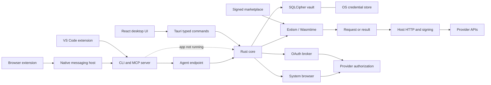
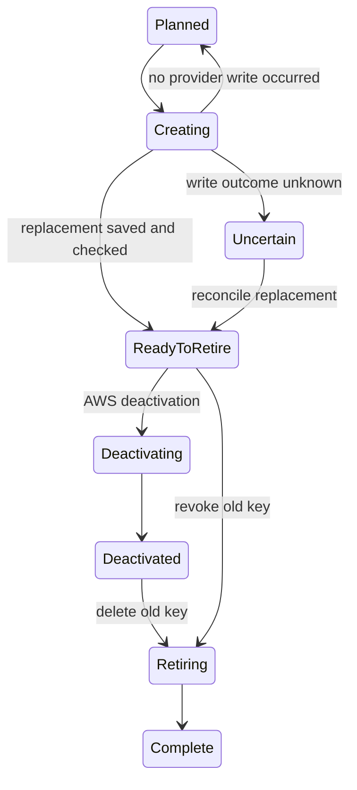

# Architecture

The repository follows the explicit contracts, cohesive modules, and small deterministic functions in `../common/code.md`. The provider manifest is the source of truth for permissions, connection fields, credential fields, and UI capabilities. Rust types generate the renderer's TypeScript command and metadata contract.

| Directory              | Responsibility                                                            |
| ---------------------- | ------------------------------------------------------------------------- |
| `crates/plugin-api`    | Versioned provider protocol                                               |
| `crates/core`          | Vault, authorization, plugin runtime, HTTP, rotation                      |
| `plugins/*`            | Provider manifests and pure request/response adapters                     |
| `apps/desktop`         | Minimal React interface and native IPC                                    |
| `apps/cli`             | `getkeys` CLI, `getkeys://` references, MCP server, native messaging host |
| `extensions/browser`   | MV3 extension that spots keys on provider pages and saves them            |
| `extensions/vscode`    | Key tree, references, `.env` writing, and tasks with keys                 |
| `services/auth-broker` | Confidential OAuth exchanges for Supabase and Vercel                      |
| `tools/xtask`          | Signing, packaging, type generation, live checks                          |

## Provider boundary

A provider package exports `describe()` and `run(Call)`. It receives an operation, non-secret configuration, the previous response, and its continuation cursor. It returns an HTTP request, a result, or a safe error. The host owns bearer authentication, AWS SigV4, and sealed-box injection of generated secrets. Authentication tokens are not passed to guest code. Credential values returned by provider APIs necessarily pass through the adapter that parses them.

Guests have no WASI, filesystem, environment, direct HTTP imports, or arbitrary host functions. The host restricts HTTPS requests to declared DNS hosts and refuses redirects. Each guest has a 64 MiB memory limit and a five-second execution limit; an operation permits at most 100 HTTP steps. Signed catalog entries bind the manifest and SHA-256 artifact digest. These boundaries protect against changed artifacts and undeclared access, not a malicious approved publisher granted access to its declared provider domains.

## Keys and fields

The manifest describes every key with `credential_fields`, and the key an account signs in with using `account_fields`. Each field has a label, a `secret` flag (default `true`), and an optional `env` variable name. Plugins can return non-secret `details` with a credential, such as an AWS access key ID or a Supabase project URL. The core turns the schema, stored value, and details into one `KeyField` list per key. The renderer receives non-secret values and only the availability of secret values. That gives every provider the same table, per-field copy, explicit reveal, and **Copy .env**, which writes `ENV=value` lines for exported fields to the clipboard for 30 seconds.

Connecting an account stores its own credential as a management key (`sign_in`). The renderer lists it with the account under Providers. When it was found on this device (a CLI session, AWS profile, or environment variable), it is also one of the person's keys, so it is listed under Keys too; it changes at its source, and removing it removes the account. Switching such an account to a pasted or dedicated key keeps the local key as an ordinary key. The snapshot describes each installed plugin by its installed manifest, so the renderer asks only for operations the running code supports until an update is approved. `scan_sources` connects each local session not seen before (for one plugin when it is added, or for every added plugin on refresh). The renderer then calls `sync` for each account and place: the account itself for account-level plugins (`account_credentials`), otherwise each resource. It runs these as a cancellable job that stops between calls. `sync` records each key's resource name and forgets keys the provider no longer lists. Accounts the user disconnected are never reconnected by a refresh. `dedicate` creates and validates a token named `GetKeys` with the current management key, then switches the account to it. A borrowed CLI token stays usable elsewhere, so it is kept as an ordinary key; a previously dedicated token is revoked. `disconnect` revokes the dedicated token too. Plugins without token creation replace the management key through `connect_token`, and a rotation never retires one. `delete` revokes a key through `revoke_credential` when the plugin supports it; otherwise it returns the provider's page, and `confirm_deleted` removes the key after the user deletes it there. At startup, GetKeys installs catalog updates that don't widen a plugin's permissions; broader updates still need approval. `uninstall` disconnects each account of the provider, forgets its keys and connection records, then removes the package.

A refresh runs local connection, listing, and checking for every provider and account concurrently, bounded per stage. The native host serves those slow, network-bound commands (`sync`, `resources`, `connect_local`, `scan_sources`, `check`) on a fork of the app: a second connection to the same vault, opened under the shared lock and used after it is released. The vault runs in WAL mode and every write takes an `IMMEDIATE` transaction, so concurrent writers queue on the database lock instead of failing. Renewing an expiring management key keeps that transaction open, so two forks never spend a rotating refresh token twice. After listing, `check` validates each key no provider listing confirmed (imported keys, and keys of providers that can't list); a `401` stores a problem, which the snapshot reports as `problem` alongside expiry and sign-in failures. A `403` while listing (`sync`, `resources`) is not a failure: the account's keys get the problem `NO_PERMISSION` ("can't be checked") and the listing carries on. A sign-in found on this device that the provider turns away (`401`, or `403` on its identity) is saved as a found key with the reason instead of failing `connect_local`; it is removed once the sign-in works. The renderer puts keys with a problem other than `NO_PERMISSION`, and keys without a secret, under **Others** with the reason, in neutral styling. Errors from any command are appended to `getkeys.log` next to the vault (restarted past 1 MB), so the UI can stay quiet about refusals.

Keys added by hand without a provider (`save_custom`) have the credential type `custom` and no connection. Their fields are the variable names the person chose; secret values go to the encrypted value and the rest are stored as details. Every key carries `groups`, set with `set_groups` and kept across syncs and rotations. The renderer scopes Refresh to the accounts behind a group's keys and Export to its keys. Groups made in the renderer before they have keys are remembered in local storage. Version 0.2 put refused keys in a `Failed` group; a refresh now takes keys out of it. `export_env` is a native command, not a vault request: the renderer sends credential IDs, field names, and variable names, and the host writes the values to a file picked in the system save dialog, or to the clipboard for 60 seconds. Values never pass through the renderer.

## New keys

GetKeys is key-oriented: it has no project or consumer records. The renderer's New key dialog reveals one step at a time (provider, account, project, name) and ends in `create`, `import`, `save_key`, or `save_custom`, then `set_groups` when a group is open. The provider makes the key wherever it can; pasting is a fallback.

Providers that make keys only on their own page declare `key_page`, a URL template with `{name}` and `{owner}`. The native `capture_key` command remembers the clipboard, sends `open_key_page` (the template filled in, URL-encoded, with empty parameters dropped), and polls the clipboard for up to 15 minutes. The first new value that matches the provider's `key_pattern` (or a generic token shape) goes to `save_captured`, which checks it, saves it under the account or on its own, and joins the groups of the key it replaces; the clipboard is cleared if it still holds the key. `cancel_capture` stops the wait.

Every key records its `origin` (`created`, `rotated`, `captured`, `pasted`, `listed`, `found`, `signed_in`); keys saved before 0.3 get one inferred from how they are stored. The renderer shows it as the key's source.

`rotate_now` replaces a key without a review step: the plugin's `rotate_credential` if it has one, otherwise a planned rotation that creates the replacement, then retires the old key (retrying the retirement a few times). It refuses keys whose provider makes keys only on its page; the renderer captures the new key for those and deletes the old one. Manifests with `revoke_by_value` (GitHub) revoke a key by sending its value (`SecretInjection::JsonArray`), so `delete` works for keys GetKeys can't look up by ID.

A key may need a project, workspace or IAM user that doesn't exist yet. Plugins describe what their keys belong to in `new_resource`, and providers whose keys belong to the account (`account_credentials`, `account_keys`) skip that step. With `create_resource`, `owners` lists the organisations a connection can create in (for plugins with `list_owners`), `choices` lists the account's own choices for `listed` options such as IAM policies, and `create_resource` makes one. Plugins wait for slow provider operations by polling with `wait_ms`, which the host honours (up to ten seconds) before sending. When the manifest asks for a `generated` secret, the core makes it up and saves it as a custom key before the request, so a failed or uncertain creation never loses it; the host puts it in the request body and the guest never sees it. The renderer and `getkeys new <provider> --new-project NAME [--option KEY=VALUE]` then poll `resources` until the new one is no longer `pending`, and create the key in it. When the API can't make one, `open_resource_page` opens the provider's `new_resource.page`; the renderer then picks up the new resource by listing `resources` again. The `write_secret` operation is kept only so older installed manifests still load; nothing calls it.

## Providers without code

A manifest with no Wasm artifact is a declarative provider. It declares `sources` (environment variables, files with a format and a path into them), a `key_pattern`, and a `check` request. `discover` reads those sources, and each key found is saved as a key the provider owns (`found:<source>`), with no account. `check` sends the declared request with the key; a `401` or `403` marks it invalid. Managed providers use the same sources to find sign-ins. Keys typed in for such a provider (`save_key`) are stored the same way. Pasting a new value into a key found on this device retires the found key and stores the new one under its own ID, so the next refresh doesn't put the old value back. Removing a provider forgets the keys it owns.

## CLI, agents, and extensions

The desktop app serves the core over a local agent endpoint: a named pipe `getkeys-agent` on Windows, a `0600` socket in the data folder elsewhere. The CLI uses it while the app runs, so the window updates (`vault-changed`), and opens the vault directly otherwise. `getkeys mcp` is a stdio MCP server over the same client; it can be turned off in Settings (`prefs.json`), and every value it hands an agent is written to the audit log. The browser extension reaches `getkeys native-host`, which answers only the extension's fixed ID, gives it the providers' key patterns, and saves keys it sends. The VS Code extension runs the CLI (`ls --json`, `get`, `env`, `run`). The tray, the Ctrl+Shift+K quick-copy palette, single-instance handling, and `getkeys://` deep links live in the desktop shell.

## Vault and frontend

SQLCipher encrypts the database and journals. A random 256-bit vault key is stored through the OS credential store. Startup fails if the key is missing for an existing vault. The renderer receives metadata until an explicit reveal. Browser builds have no vault fallback, local-storage credential store, or bundled sample accounts.

Backups use age passphrase encryption. Restoring into a populated vault fails. The audit trail records action names and record IDs, never secret payloads. Same-user malware, screen capture, clipboard history, and secrets deliberately inherited by child processes are outside database encryption's protection.

## Rotation

A unique active rotation per account/resource prevents two AWS workflows racing for the second key slot. State transitions compare the persisted state before mutating a provider. A lost creation response is never retried automatically. Reconcile using the provider's replacement ID; one-time values must be imported if the response was lost.

GetKeys doesn't know where a key is used, so the old key stays working until the person has swapped the replacement in and asks to retire it. AWS deactivation and deletion are separate steps. Unknown retirement outcomes use inventory reconciliation before retrying. Plugin changes are blocked while a rotation is active. Rotations stored by older versions in the `stored`, `distributing`, or `awaiting_verification` states load as `ReadyToRetire`.

Guided GitHub/Vercel replacement uses the same stages. Create and import a replacement with the required scopes, select it from the old key's replacement dialog, then swap it in. Revoke the old token in the provider dashboard and explicitly confirm that action in GetKeys. The audit event records this as manual confirmation. Automated lifecycle operations are exposed only for credentials whose scope can be preserved.
