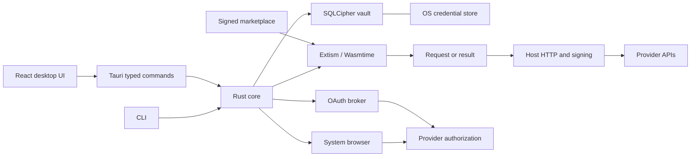
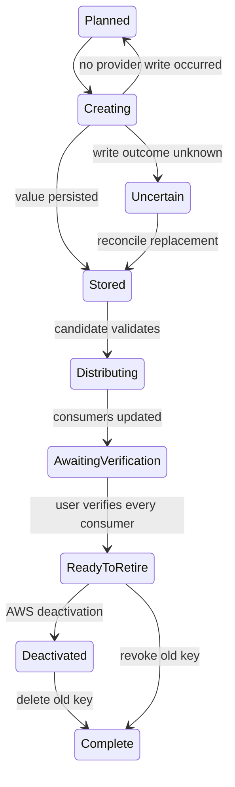

# Architecture

The repository follows the explicit contracts, cohesive modules, and small deterministic functions in `../common/code.md`. The provider manifest is the source of truth for permissions, connection fields, credential fields, and UI capabilities. Rust types generate the renderer's TypeScript command and metadata contract.

| Directory | Responsibility |
| --- | --- |
| `crates/plugin-api` | Versioned provider protocol |
| `crates/core` | Vault, authorization, plugin runtime, HTTP, rotation |
| `plugins/*` | Provider manifests and pure request/response adapters |
| `apps/desktop` | Minimal React interface and native IPC |
| `apps/cli` | Metadata, auth, typed commands, process injection, backups |
| `services/auth-broker` | Confidential OAuth exchanges for Supabase and Vercel |
| `tools/xtask` | Signing, packaging, type generation, live checks |

## Plugin boundary

A plugin exports `describe()` and `run(Call)`. It receives an operation, non-secret configuration, the previous response, and its continuation cursor. It returns an HTTP request, a result, or a safe error. The host owns bearer authentication, AWS SigV4, GitHub sealed-box encryption, and consumer-value injection. Authentication tokens are not passed to guest code. Credential values returned by provider APIs necessarily pass through the adapter that parses them.

Guests have no WASI, filesystem, environment, direct HTTP imports, or arbitrary host functions. The host restricts HTTPS requests to declared DNS hosts and refuses redirects. Each guest has a 64 MiB memory limit and a five-second execution limit; an operation permits at most 100 HTTP steps. Signed catalog entries bind the manifest and SHA-256 artifact digest. These boundaries protect against changed artifacts and undeclared access, not a malicious approved publisher granted access to its declared provider domains.

## Vault and frontend

SQLCipher encrypts the database and journals. A random 256-bit vault key is stored through the OS credential store. Startup fails if the key is missing for an existing vault. The renderer receives metadata until an explicit reveal. Browser builds have no vault fallback, local-storage credential store, or bundled sample accounts.

Backups use age passphrase encryption. Restoring into a populated vault fails. The audit trail records action names and record IDs, never secret payloads. Same-user malware, screen capture, clipboard history, and secrets deliberately inherited by child processes are outside database encryption's protection.

## Rotation

A unique active rotation per account/resource prevents two AWS workflows racing for the second key slot. State transitions compare the persisted state before mutating a provider. A lost creation response is never retried automatically. Reconcile using the provider's replacement ID; one-time values must be imported if the response was lost. Idempotent destination writes resume after interruption. A successful write is not deployment verification.

The old key remains until verification and a separate retirement action. AWS deactivation and deletion are separate steps. Unknown retirement outcomes use inventory reconciliation before retrying. Plugin changes and affected consumer edits are blocked while a rotation is active. With no registered consumers, the UI explicitly requires the operator to update and test untracked consumers before retiring the old key.

Guided GitHub/Vercel replacement uses the same distribution and consumer-verification stages. Create and import a replacement with the required scopes, select it from the old key's replacement dialog, then update and verify consumers. Revoke the old token in the provider dashboard and explicitly confirm that action in GetKeys. The audit event records this as manual confirmation. Automated lifecycle operations are exposed only for credentials whose scope can be preserved.
